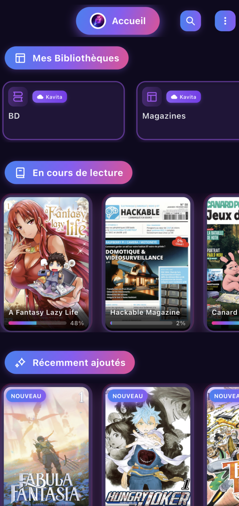
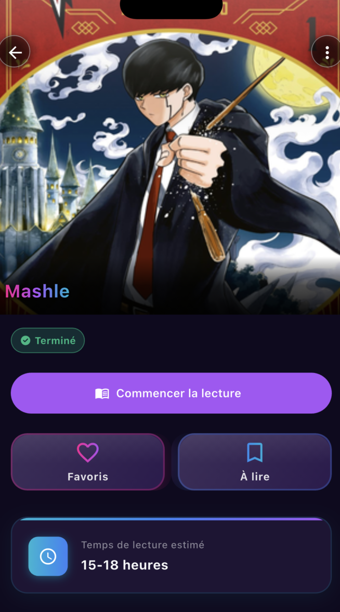
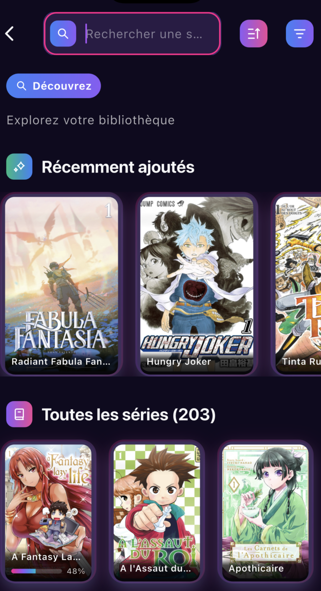
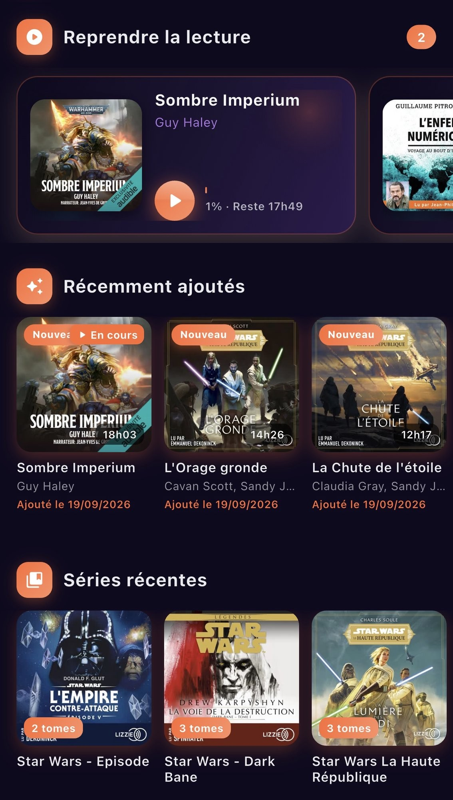
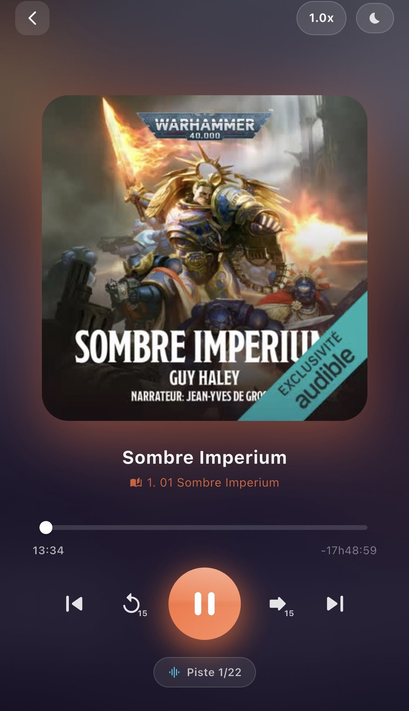
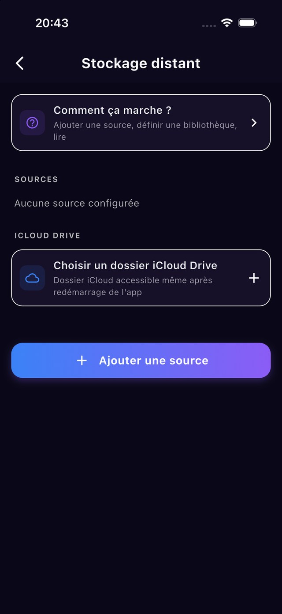
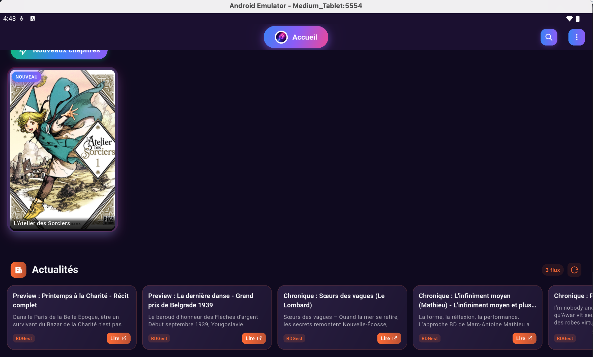
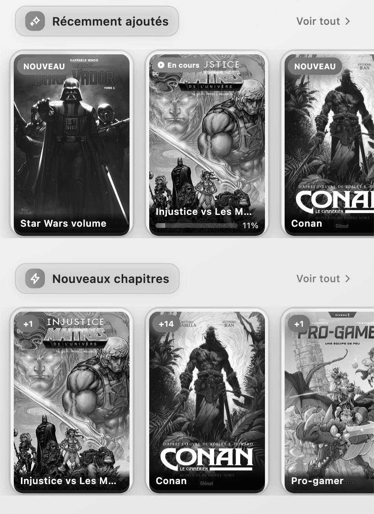
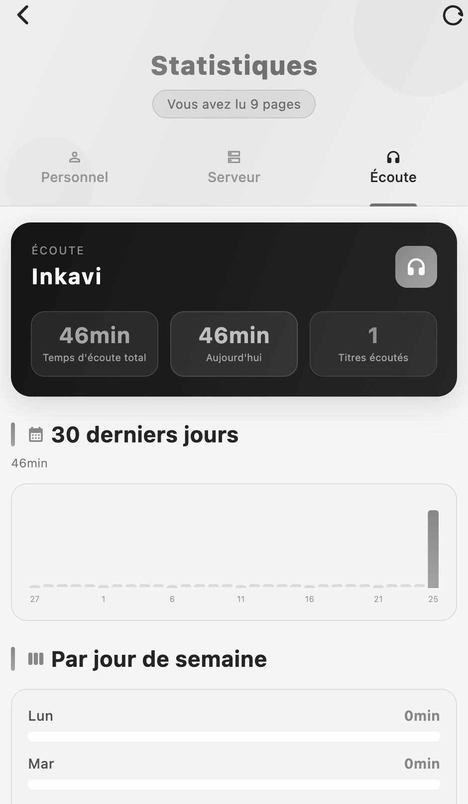
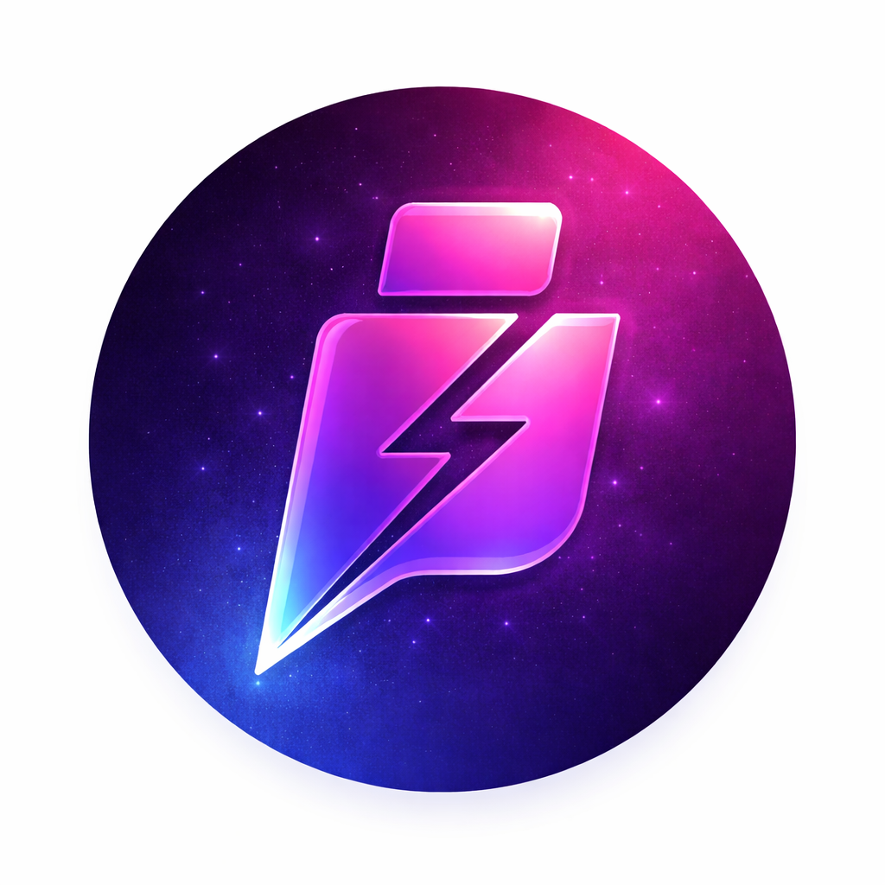

  

  
<strong>VOTRE BIBLIOTHÈQUE, PARTOUT</strong>

  <h1>Toutes vos lectures. Un seul univers.</h1>
  
Mangas, BD, ebooks et livres audio. Retrouvez vos collections sur iPhone, iPad, Android et Mac.

  
<strong>Gratuit · Sans publicité · Lecture hors ligne</strong>

  

  

    <a href="https://apps.apple.com/fr/app/inkavi/id6759855171"><strong>App Store · iOS & macOS</strong></a> &nbsp; · &nbsp;
    <a href="https://github.com/crashcool69/Inkavi/releases/latest"><strong>Android · Télécharger l’APK</strong></a> &nbsp; · &nbsp;
    <a href="https://inkavi.fr"><strong>Découvrir le site ↗</strong></a>
  

   
  
  &nbsp;
  
  &nbsp;
  
  
Captures réelles de l’application, issues du site officiel.

  
<a href="#vos-collections-au-meme-endroit">Sources</a> · <a href="#le-plaisir-de-lire">Lecture</a> · <a href="#premiers-pas">Premiers pas</a> · <a href="#suivre-inkavi">Communauté</a>

---

<h2 id="vos-collections-au-meme-endroit">Vos collections, au même endroit.</h2>

Inkavi réunit plusieurs façons de retrouver vos contenus : un serveur Kavita, un serveur Audiobookshelf ou un espace de stockage distant. Choisissez la source qui correspond à votre bibliothèque.

<table>
  <tr><th align="left">Kavita</th><th align="left">Audiobookshelf</th><th align="left">NAS & cloud</th></tr>
  <tr>
    <td>Connectez votre lien OPDS, retrouvez vos bibliothèques et votre progression. Ajoutez plusieurs serveurs et réunissez leurs collections avec le mode Fusion.</td>
    <td>Parcourez vos livres audio et podcasts. Retrouvez un lecteur avec vitesse réglable, sauts de 15 secondes et minuteur, ainsi que CarPlay et Android Auto.</td>
    <td>Accédez à vos dossiers via SMB, WebDAV, SFTP ou FTP, ainsi qu’à Google Drive, OneDrive, Dropbox, Box, pCloud et iCloud Drive.</td>
  </tr>
</table>

Le stockage distant prend actuellement en charge <strong>CBZ, ZIP et EPUB</strong>. Les fichiers PDF et CBR y sont annoncés pour une prochaine évolution. Cette source fonctionne sans serveur Kavita.

  
  &nbsp;
  
  &nbsp;
  
  
Lire. Écouter. Retrouver ses dossiers.

<h2 id="le-plaisir-de-lire">Le plaisir de lire, à votre rythme.</h2>

<table>
  <tr><th align="left">Un lecteur qui s’adapte</th><th align="left">Une bibliothèque personnelle</th></tr>
  <tr><td>Pagination, lecture de droite à gauche et défilement Webtoon. Lecteur EPUB avec Readium. Préférences conservées par série et par tome.</td><td>Thème sombre, thème Liseuse et fonds personnalisables. Statistiques de lecture et d’écoute pour retrouver vos habitudes.</td></tr>
  <tr><th align="left">La bonne page, au bon moment</th><th align="left">Vos séries à suivre</th></tr>
  <tr><td>Reprise de lecture, marque-pages avec notes et téléchargement pour lire hors connexion. Préparez vos contenus avant de partir.</td><td>Intégrations AniList et MangaBaka pour enrichir le suivi de vos mangas. Widget Android pour accéder à vos lectures depuis l’accueil.</td></tr>
</table>

   
  
  
Une interface pensée aussi pour les grands écrans.

  
<strong>Explorer le thème Liseuse et les statistiques d’écoute</strong>

   
  

    
    &nbsp;
    
  

<h2 id="premiers-pas">Trois étapes pour commencer.</h2>

<ol>
  <li><strong>Installez Inkavi.</strong> Sur iPhone, iPad ou Mac, passez par l’<a href="https://apps.apple.com/fr/app/inkavi/id6759855171">App Store</a>. Sur Android, ouvrez la <a href="https://github.com/crashcool69/Inkavi/releases/latest">dernière publication</a> et téléchargez son fichier APK.</li>
  <li><strong>Ajoutez votre source.</strong> Pour Kavita, copiez votre lien OPDS depuis vos paramètres utilisateur, puis collez-le dans Inkavi. Pour Audiobookshelf, ajoutez l’adresse du serveur et connectez votre compte. Pour le NAS ou le cloud, choisissez un connecteur dans le stockage distant.</li>
  <li><strong>Choisissez votre prochaine lecture.</strong> Ouvrez une bibliothèque, sélectionnez un titre et personnalisez votre lecteur.</li>
</ol>

  
<strong>À savoir avant la première connexion</strong>

  <ul>
    <li>Pour la source Kavita, le site recommande <strong>Kavita 0.8.9.1 ou supérieur</strong>. Votre serveur doit être accessible depuis l’appareil utilisé.</li>
    <li>La connexion par clé OPDS est disponible ; la connexion par identifiant et mot de passe permet aussi de gérer plusieurs comptes.</li>
    <li>La source Audiobookshelf demande votre propre serveur ABS. Elle reste facultative.</li>
    <li>Pour lire sans réseau, téléchargez vos contenus à l’avance. Le cache seul dépend des pages déjà chargées et de la source utilisée.</li>
    <li>Les autorisations nécessaires à l’installation d’un APK varient selon votre appareil Android.</li>
  </ul>

<h2 id="suivre-inkavi">Le prochain chapitre s’écrit avec vous.</h2>

Inkavi est un projet personnel gratuit. Le développement se concentre désormais sur la stabilité, la maintenance et les corrections ; les retours précis de la communauté aident à guider ces améliorations.

  <a href="https://github.com/crashcool69/Inkavi/releases"><strong>Versions & nouveautés</strong></a> ·
  <a href="https://github.com/crashcool69/Inkavi/issues"><strong>Signaler un problème</strong></a> ·
  <a href="https://www.reddit.com/r/Inkavi/"><strong>Communauté Reddit</strong></a> ·
  <a href="https://inkavi.fr/#support"><strong>Soutenir Inkavi</strong></a>

Pour signaler un bug, indiquez votre appareil, les versions d’Inkavi et du serveur, ainsi que les étapes permettant de reproduire le problème.

  
<strong>À propos du dépôt et des services compatibles</strong>

  
Ce dépôt public présente Inkavi et distribue ses publications. Selon la mention du dépôt, le code source de l’application reste privé et n’est pas distribué publiquement.

  
Inkavi est un client indépendant, non affilié à Kavita ou Audiobookshelf. Il accède aux contenus que vous fournissez via vos propres sources.

  
<a href="https://www.kavitareader.com/">Kavita</a> · <a href="https://wiki.kavitareader.com/">Documentation Kavita</a>

---

  
  

  
<strong>Votre bibliothèque. Votre rythme.</strong>

  
<a href="https://inkavi.fr">inkavi.fr</a>

